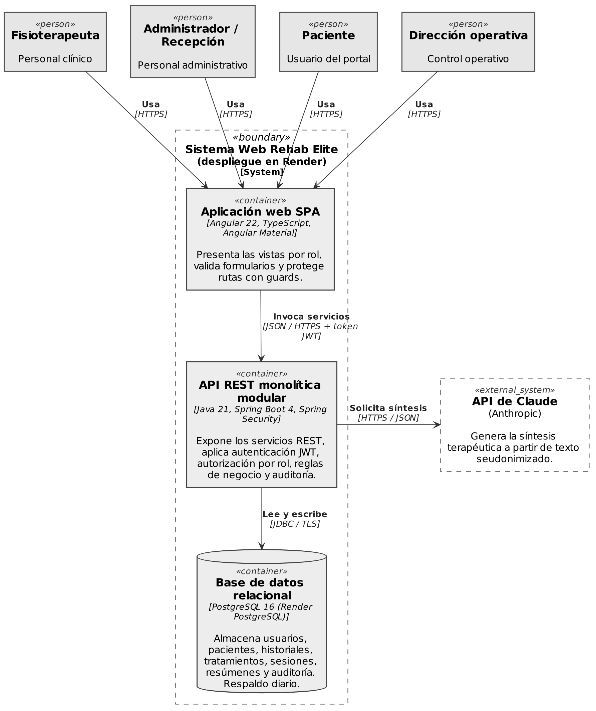

# Rehab Elite

[](https://github.com/Ptrickill/Titulacion/actions/workflows/ci.yml)

Clinical management and therapy follow-up web system for a physiotherapy clinic in Quito, Ecuador. Capstone project.

It covers patient registration and clinical records, treatments with ICD-10 diagnoses, therapy sessions with pain-score tracking, AI-assisted treatment summaries (always reviewed by a physiotherapist), a read-only patient portal and reports for the operations director. Every action on clinical data is recorded in an append-only audit log.

The user interface and API error messages are in Spanish; code, database objects and technical documentation are in English.

## Tech stack

| Layer | Technology |
|---|---|
| Backend | Java 21, Spring Boot 4.1, Spring Security (JWT HS256 / OAuth2 Resource Server), Spring Data JPA, Flyway, Spring Modulith, Bean Validation, MapStruct, springdoc-openapi |
| Frontend | Angular 22 + Angular Material |
| Database | PostgreSQL 16 |
| AI | Claude API (Anthropic) |
| Testing | JUnit 5, Mockito, Testcontainers, Vitest, Playwright |

## Project structure

```
rehab-elite/
├── backend/                         Spring Boot REST API (modular monolith)
│   ├── Dockerfile                   deployment image (Render, compose profile "full")
│   └── src/main/
│       ├── java/ec/rehabelite/
│       │   ├── auth/                users (create, activate/deactivate), JWT login, security
│       │   ├── patients/            patient registration (national ID check, record number) and personal data
│       │   ├── clinicalrecords/     clinical records and treatments
│       │   ├── sessions/            therapy sessions
│       │   ├── aisummary/           AI summaries
│       │   ├── portal/              patient portal
│       │   ├── reports/             operational reports
│       │   ├── audit/               audit log
│       │   └── shared/              cross-cutting config and error handling
│       └── resources/
│           ├── application.yml      common settings
│           ├── application-dev.yml  local development (default profile)
│           └── db/migration/        Flyway migrations (data model)
├── frontend/                        Angular 22 + Material SPA (see frontend/README.md)
├── docs/                            functional documentation (Spanish)
├── docker-compose.yml               optional PostgreSQL 16 (port 5433) + backend
├── .editorconfig
├── .env.example                     environment variable template
└── CLAUDE.md                        permanent project rules
```

Each module is split into `web/` (controllers and DTOs), `application/` (services) and `domain/` (entities and repositories). Modules talk to each other only through the public types in their root package; `ModularityTests` enforces it.

REST endpoints live under `/api` in plural kebab-case (`/api/patients`, `/api/clinical-records`, `/api/therapy-sessions`, `/api/ai-summaries`, `/api/audit-logs`, ...). Errors are returned as RFC 9457 `ProblemDetail`.

## Documentation

Architecture diagrams (C4, domain and data models), the prototype screens and the project documentation are indexed in [docs/README.md](docs/README.md).

Architecture overview (C4 Level 2, containers):



## Requirements

- JDK 21 or later
- Node.js `^22.22.3` (required by Angular CLI 22) — frontend only; the CLI runs through `npx`
- PostgreSQL 16 installed locally (main development database, port 5432)
- Docker Desktop (Testcontainers tests, backend image, optional compose environment — see [Docker](#docker))

## Getting started

1. **Environment variables.** Copy the template and fill in every value marked `TODO`:

   ```powershell
   Copy-Item .env.example .env
   ```

   | Variable | Purpose |
   |---|---|
   | `DB_URL`, `DB_USERNAME`, `DB_PASSWORD` | PostgreSQL connection |
   | `POSTGRES_DB` | Database name of the optional Docker PostgreSQL (`docker-compose.yml`) |
   | `JWT_SECRET`, `JWT_EXPIRATION_MINUTES` | Token signing key (≥ 32 chars) and lifetime |
   | `ADMIN_EMAIL`, `ADMIN_PASSWORD` | Initial administrator account |
   | `ANTHROPIC_API_KEY` | Claude API key (AI summaries) |
   | `CORS_ALLOWED_ORIGINS` | Comma-separated allowed origins |

   `.env` is git-ignored and must never be committed.

2. **Database.** Create the `rehab_elite` database and an owner user. If that user cannot create extensions, run once as `postgres`, connected to `rehab_elite`:

   ```sql
   CREATE EXTENSION IF NOT EXISTS pg_trgm WITH SCHEMA public;
   CREATE EXTENSION IF NOT EXISTS unaccent WITH SCHEMA public;
   ```

3. **Backend.** Flyway creates the schema on startup (profile `dev` by default):

   ```powershell
   cd backend
   .\mvnw.cmd spring-boot:run
   ```

   - Health: <http://localhost:8080/actuator/health>
   - OpenAPI UI: <http://localhost:8080/swagger-ui.html> (public; use **Authorize** with the token from `POST /api/auth/login`)
   - On first start, if no administrator exists, the account from `ADMIN_EMAIL` / `ADMIN_PASSWORD` is created

4. **Frontend.** In a second terminal:

   ```powershell
   cd frontend
   npm install
   npm start
   ```

   Open <http://localhost:4200>. Requests to `/api` are proxied to the backend on port 8080.

5. **Tests:**

   ```powershell
   cd backend;  .\mvnw.cmd clean verify        # Docker must be running
   cd frontend; npx ng test --watch=false
   ```

## Docker

Docker is used for three things; **the main development database is still the PostgreSQL installed on Windows** and Docker never modifies it.

| Use | What runs | Command |
|---|---|---|
| Integration tests | A throwaway `postgres:16` started by Testcontainers | `.\mvnw.cmd verify` (in `backend/`) |
| Deployment (Render) | `backend/Dockerfile` | built by Render from the repository |
| Optional full environment | `docker-compose.yml`: `db` (+ `backend` with profile `full`) | see below |

### Ports

| Port | Service |
|---|---|
| `5432` | PostgreSQL installed on Windows — main development database (`DB_URL` in `.env`) |
| `5433` | PostgreSQL 16 in Docker (`db` service). Mapped to 5433 so it never collides with 5432 |
| `8080` | Backend (local `spring-boot:run` **or** the `backend` container — not both at once) |

Inside the compose network the backend reaches the database as `db:5432`; compose overrides `DB_URL` for the container, so `.env` keeps pointing at the Windows database.

### Commands (from the repository root)

```powershell
docker compose up -d db                      # PostgreSQL 16 only, on localhost:5433
docker compose ps                            # status; db should be "healthy"
docker compose --profile full up --build     # db + backend image on http://localhost:8080 (add -d to detach)
docker compose --profile full down           # stop and remove containers; data stays in the db-data volume
docker compose --profile full down -v        # same, and also delete the Docker database volume
```

The compose database reads `POSTGRES_DB`, `DB_USERNAME` and `DB_PASSWORD` from `.env`. To point the local backend or DBeaver at it, use `jdbc:postgresql://localhost:5433/<POSTGRES_DB>`.

### Backend image

`backend/Dockerfile` is a multi-stage build: `eclipse-temurin:21-jdk` compiles with the Maven wrapper (the dependency layer is cached until `pom.xml` or `.mvn/` change) and `eclipse-temurin:21-jre` runs the Spring Boot layered jar as the non-root user `spring`. The image:

- listens on `PORT` (default `8080`; Render sets it),
- runs with profile `prod` (common settings only, no dev debug logging),
- has a `HEALTHCHECK` on `/actuator/health`,
- takes all configuration from environment variables (same names as `.env`); no `.env` is copied into it.

Tests are not run during the image build; run `.\mvnw.cmd verify` before pushing.

### Troubleshooting Testcontainers on Windows

`Could not find a valid Docker environment` means Testcontainers could not reach the Docker daemon:

1. Make sure **Docker Desktop is running** (whale icon steady, `docker version` shows a *Server* section).
2. Docker Desktop → *Settings → General*: keep **Use the WSL 2 based engine** enabled. Testcontainers talks to Docker Desktop through the default named pipe `npipe:////./pipe/docker_engine`; no TCP exposure (port 2375) is needed.
3. If `docker` works only from an elevated terminal, add your Windows user to the `docker-users` group and sign out/in.
4. If you use a non-default context or a remote engine, tell Testcontainers explicitly in `%USERPROFILE%\.testcontainers.properties`:

   ```properties
   docker.host=npipe:////./pipe/docker_engine
   ```

5. `client version 1.xx is too old` errors come from an outdated docker-java client; keep Spring Boot (which manages the Testcontainers version) up to date rather than downgrading Docker Desktop.

## Workflow

Branches `feature/HU-XX-short-description` from `develop`; commits in English following Conventional Commits with the issue number, e.g. `feat(patients): register patient #8`. See [CLAUDE.md](CLAUDE.md) for the full rules.

## Continuous integration

[`.github/workflows/ci.yml`](.github/workflows/ci.yml) runs on every push and pull request to `main` and `develop`:

| Job | Steps |
|---|---|
| Backend | Temurin 21 with Maven cache → `./mvnw -B verify` (Testcontainers uses the Docker engine of `ubuntu-latest`) → uploads `backend/target/surefire-reports` as the `surefire-reports` artifact |
| Frontend | Node 22 with npm cache → `npm ci` → `npx ng test --watch=false` → `npx ng build` |

No secrets are needed: the backend tests use the synthetic values in `application-test.yml`. A pull request should only be merged when both jobs are green.

## Project documentation

- [`docs/user-stories.md`](docs/user-stories.md) — user stories and acceptance criteria (Spanish)
- [`docs/evidence/`](docs/evidence/) — sprint evidence (boards, burndown, CI runs, screenshots, minutes)
- GitHub templates: [user story issue](.github/ISSUE_TEMPLATE/user-story.md) and [pull request](.github/pull_request_template.md)
